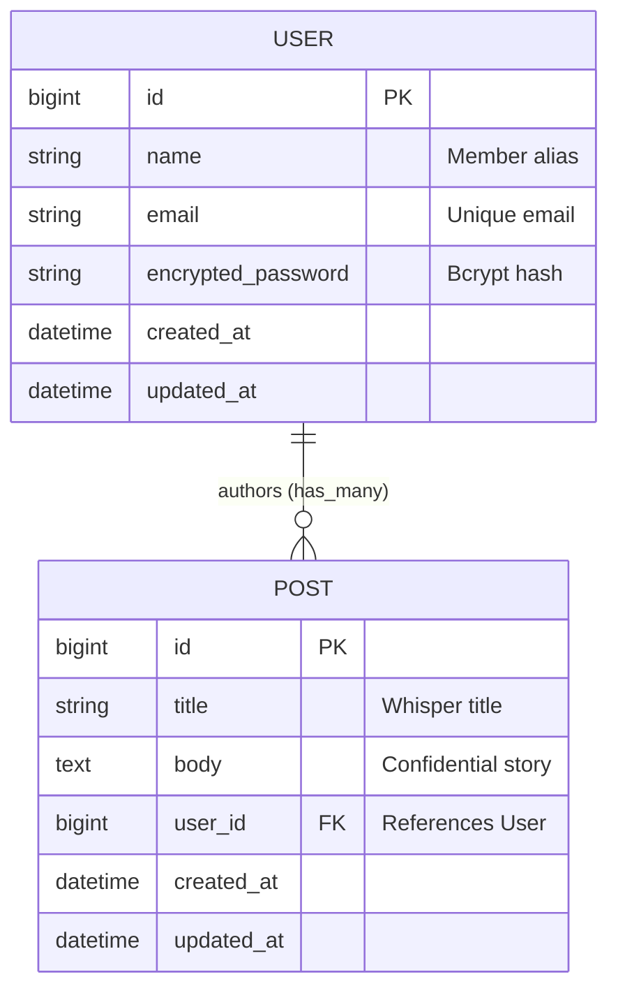

# 🗝️ Members Only! — The Secret Clubhouse

An exclusive authentication-driven clubhouse built with **Ruby on Rails 7.2** and **Devise** for [The Odin Project](https://www.theodinproject.com/lessons/ruby-on-rails-members-only).

In this application, users can read confidential dispatches ("whispers") shared within the society. However, author identities are strictly confidential:
- **Outside the Clubhouse (Guests)**: Visitors can read the stories and titles, but author names and avatars are masked as `Anonymous Member` with locked ciphers.
- **Inside the Clubhouse (Authenticated Members)**: Signed-in members see the true author of every post, verified member badges, author initials, and have clearance to whisper their own secret posts.

---

## ✨ Features & Highlights

- **Robust Authentication with Devise**: Full authentication system with secure password hashing (`bcrypt`), sessions, registrations, and account management.
- **Custom User Attributes**: Extended Devise registration to permit and store member aliases (`name`) alongside email and password.
- **Role & Access Protection**:
  - `PostsController#before_action :authenticate_user!, only: [:new, :create]` restricts post authoring to logged-in users only.
  - Automatic author assignment: `current_user.posts.build(post_params)` guarantees that posts are securely tied to the authenticated user.
  - Dynamic author visibility in views based on `user_signed_in?`.
- **Obsidian Vault & Clubhouse Aesthetic**:
  - Deep midnight canvas with subtle radial backdrop glow.
  - Polished amber/gold accents, frosted glass cards (`backdrop-filter: blur(16px)`), micro-interactions, and status indicators.
  - Modern typography powered by Google Fonts (`Plus Jakarta Sans` and `JetBrains Mono`).
- **N+1 Query Prevention**: Eager loading of associated authors with `Post.includes(:user)`.
- **Comprehensive Test Suite**: Automated Minitest suite covering models, associations, validations, controller authorization, and guest vs. member author visibility.

---

## 🗄️ Data Models & Architecture



### Models
1. **User (`app/models/user.rb`)**:
   - `has_many :posts, dependent: :destroy`
   - `validates :name, presence: true, length: { minimum: 2, maximum: 50 }`
   - Devise modules: `database_authenticatable`, `registerable`, `recoverable`, `rememberable`, `validatable`.

2. **Post (`app/models/post.rb`)**:
   - `belongs_to :user`
   - `validates :title, presence: true, length: { minimum: 3, maximum: 120 }`
   - `validates :body, presence: true, length: { minimum: 5 }`

---

## 🚀 Getting Started

### Prerequisites
- **Ruby**: `3.3.x`
- **Rails**: `~> 7.2.4`
- **SQLite3**

### Installation

1. Navigate to the project directory:
   ```bash
   cd "c:\Users\Admin\odin-recipes\Ruby and Rails\Members Only!"
   ```

2. Install dependencies:
   ```bash
   bundle install
   ```

3. Setup and migrate the database:
   ```bash
   bin/rails db:migrate
   ```

4. Seed initial members and secret whispers:
   ```bash
   bin/rails db:seed
   ```

5. Launch the Rails server:
   ```bash
   bin/rails server
   ```
   Open [http://localhost:3000](http://localhost:3000) in your web browser.

---

## 👥 Sample Seed Accounts

The seed script creates three members with secret posts:

| Member Name | Email | Password |
|---|---|---|
| **Sherlock Holmes** | `sherlock@clubhouse.org` | `password123` |
| **Irene Adler** | `irene@clubhouse.org` | `password123` |
| **Hercule Poirot** | `poirot@clubhouse.org` | `password123` |

---

## 🧪 Running Tests

The test suite validates model validations, associations, route protection, and view cipher visibility:

```bash
bin/rails test
```

All 15 tests and 49 assertions pass:
```text
15 runs, 49 assertions, 0 failures, 0 errors, 0 skips
```

---

## 📁 Key Files Reference

- [Application Layout](file:///c:/Users/Admin/odin-recipes/Ruby%20and%20Rails/Members%20Only%21/app/views/layouts/application.html.erb) — Sticky navigation, member badge, and flash banners
- [Posts Index View](file:///c:/Users/Admin/odin-recipes/Ruby%20and%20Rails/Members%20Only%21/app/views/posts/index.html.erb) — Conditional author visibility cipher
- [New Post View](file:///c:/Users/Admin/odin-recipes/Ruby%20and%20Rails/Members%20Only%21/app/views/posts/new.html.erb) — Form to publish new secret whispers
- [PostsController](file:///c:/Users/Admin/odin-recipes/Ruby%20and%20Rails/Members%20Only%21/app/controllers/posts_controller.rb) — Authentication filter and post builder
- [User Model](file:///c:/Users/Admin/odin-recipes/Ruby%20and%20Rails/Members%20Only%21/app/models/user.rb) & [Post Model](file:///c:/Users/Admin/odin-recipes/Ruby%20and%20Rails/Members%20Only%21/app/models/post.rb)
- [Routes Configuration](file:///c:/Users/Admin/odin-recipes/Ruby%20and%20Rails/Members%20Only%21/config/routes.rb)
- [Application Stylesheet](file:///c:/Users/Admin/odin-recipes/Ruby%20and%20Rails/Members%20Only%21/app/assets/stylesheets/application.css) — Custom luxury clubhouse CSS design system
